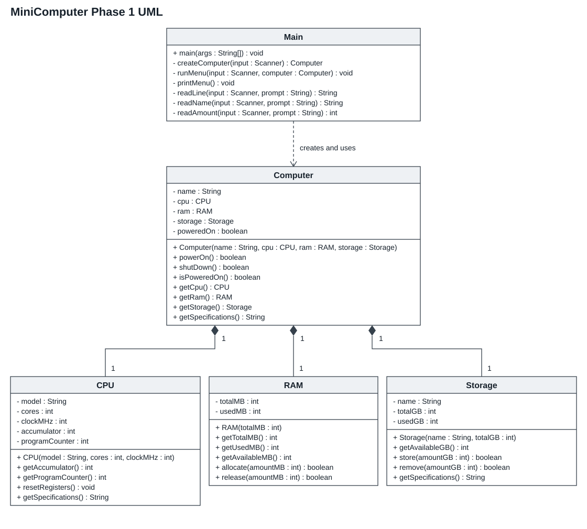

# MiniComputer Phase 1

MiniComputer is a Java console simulator. It lets you configure a computer, control its power, inspect its parts, and simulate using RAM and storage.

## Run in NetBeans

Use JDK 17 or later. In Apache NetBeans, choose **File → Open Project**, select the folder containing `pom.xml`, then choose **Run Project**. Type your answers in the Output panel and press Enter.

You can also build with `mvn package` and run with `java -jar target/minicomputer-1.0.jar`.

## Class diagram

`Computer` has one CPU, one RAM module and one storage device. Each device handles its own state. The capacity operations return `false` for invalid amounts and leave usage unchanged. RAM is measured in MB and storage in GB.

## Demo

1. Create a computer with a 4-core, 3200 MHz CPU, 2048 MB of RAM and 256 GB of storage. Try entering a negative RAM capacity first to show that the setup asks for a valid number.
2. Power it on (1), check the status (3) and display its specs (4).
3. Allocate 512 MB (6) and check that 1536 MB remains (5). Try allocating 2000 MB to show that an oversized request is rejected.
4. Release 256 MB (7) and check that 256 MB is still in use (5).
5. Store 20 GB (9), remove 5 GB (10), and check the available storage (8).
6. Shut down (2), check the status (3), and exit (0).
